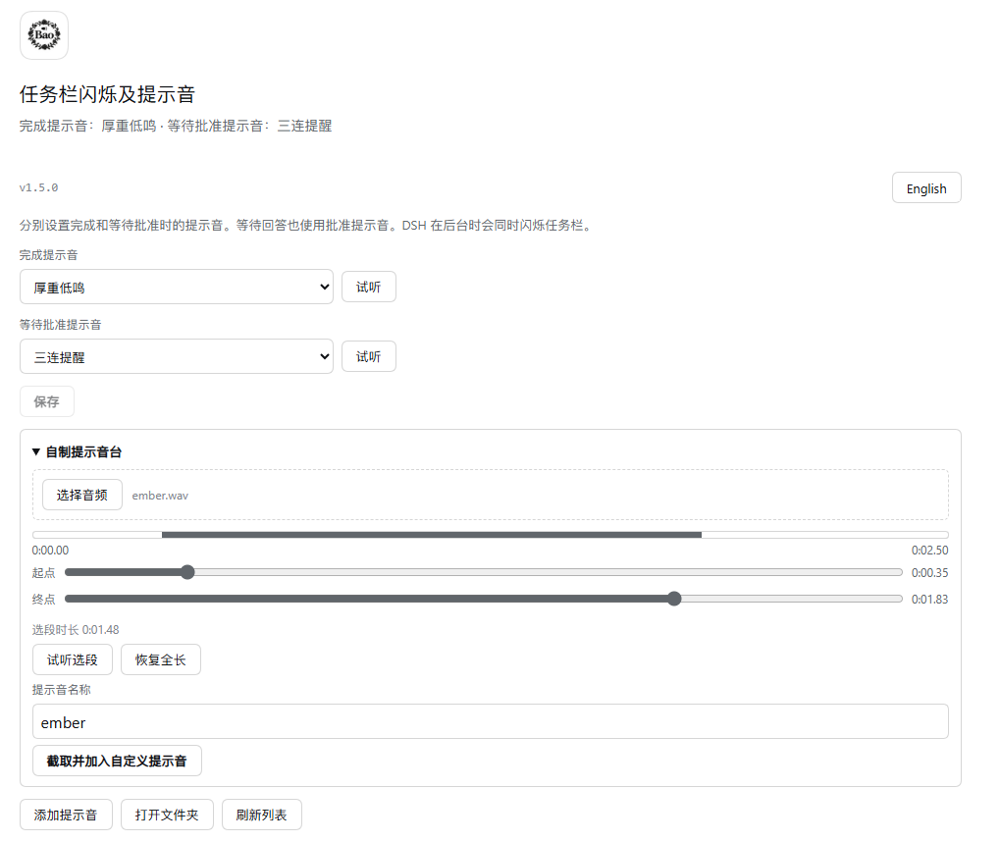

# Taskbar Flash & Sounds for DeepSeek Harness

[中文说明](README.zh.md)

A local Host + Client plugin for **DeepSeek Harness (DSH) on Windows**: it plays a reminder sound when a session finishes, when the agent asks you something, or when it waits for your approval, and it flashes the taskbar while DSH sits in the background.

No toast windows, no background service, no registry edits, no changes to DSH's approval policy.


## What it does

- **Turn finished** — a top-level session completes a turn. Manual stops, failures, forked-session resumes, and internal sub-agent completions are not reported as "done".
- **Question waiting** — the agent asks a structured question, including plan reviews. Sub-agent questions that genuinely need an answer count too.
- **Approval waiting** — the agent is blocked on a tool approval. Your approval policy and answer flow stay untouched.
- Every reminder plays one sound, in the foreground or the background, following the current system volume and mute state.
- While DSH is **in the background**, the taskbar button flashes in the Windows default colour and stops the moment you switch back. In the **foreground** it only plays the sound: no flashing, no focus stealing.

## Requirements

| | |
| --- | --- |
| OS | Windows 10/11 (`os: win32` in the manifest) |
| Host | DSH desktop app — the taskbar flash needs a real window in the Host process |
| Shell | **PowerShell 7 (`pwsh.exe`)** — see [Why pwsh](#why-pwsh) |
| Node | 18+ (tests and the sound generator only; the plugin has no build step) |

## Install

The plugin is a plain package: `index.js` (Host), `client.js` (browser half), `flash-window.ps1` (window helpers), `sounds/*.wav`, plus a `cordis.patch.yml` that the plugin manager applies for you.

**With the plugin manager**

1. Open **Settings → Plugins → Add plugin** and point it at this directory or at the repository URL; local directory installation links the checkout instead of copying it.
2. Enable **Taskbar Flash & Sounds** (`taskbar-flash`) in the Plugins page.

**By hand**

```jsonc
// <profile>/package.json
{
  "dependencies": {
    "dsh-plugin-taskbar-flash": "link:C:/path/to/dsh-plugin-taskbar-flash"
  }
}
```

The bundle ships its own patch entry, so `cordis.patch.yml` in your profile gets:

```yaml
- insert:
    - id: taskbar-flash
      name: 'dsh-plugin-taskbar-flash'
```

Keep the source directory in place: a linked plugin is loaded from its checkout.

## Configure

**Settings → Plugins → Taskbar Flash & Sounds** holds two sound menus, *Completion* and *Pending approval*. Pick, **Save**, done. Questions use the approval sound. There is a **preview** button next to each menu, and both menus list built-in and custom sounds separately.

| Value | Name | Notes |
| --- | --- | --- |
| `chime` | Classic chime | the original 0.55 s two-note reminder |
| `bright` | Bright ascending | C6–E6–G6 rising triad |
| `soft` | Soft descending | G5–E5 two soft notes |
| `triple` | Triple blip | default for approvals, three short identical beeps |
| `deep` | Deep bell | 392 Hz bell |
| `velvet` | Warm low bell | D3–A3–D4 stacked, 2.3 s tail |
| `ember` | Deep hum | default for completion, C3–G3–C4, 2.5 s |
| `resolve` | Low completion | A2–E3–A3 slow rise, 2.2 s |
| `system` | Windows system sound | the *Asterisk* sound from the current scheme |
| `none` | Silent | flash only |

All built-in sounds are synthesised from scratch; the generators are in `tools/generate-chime.py`, and the browser preview recomputes the same waveforms with the Web Audio API, so nothing is fetched from the network.

## Your own sounds

1. Click **Add sound** and pick one or more files — they are copied into `custom-sounds/` and appear in both menus immediately. Existing names are never overwritten (`mine.wav` lands as `mine-2.wav`).
2. Prefer the file manager? Click **Open folder**, or open `custom-sounds/` next to the plugin (created on first load), drop audio in, then **Refresh list**.
3. Supported: `wav` `mp3` `m4a` `ogg` `flac` `wma`, up to 12 MB each.

**Trim studio** — expand *Make a reminder sound*, pick or drop a local file, drag the start/end handles (the selection starts as the whole file), preview just the selection, name the clip and save it as WAV into `custom-sounds/`. Source files may be up to 32 MB / 10 minutes; the exported selection is capped at 15 s. Saved clips appear in both menus immediately.



The picture above is the studio working on a 2.50 s file: the darker stretch of the bar is the selection, *Start* sits at 0.35 s and *End* at 1.83 s, so the clipped clip is **1.48 s** — the line under the handles always shows that number, which is what you are really choosing. Saving adds the clip to *Your own sounds* in both menus and confirms it in green right there.

The configuration stores `file:<bare name>` and only accepts ordinary audio files inside the sound folder. If a file disappears, the affected reminder falls back to its default sound and the settings page says so.

## How it works

**Host routes** (only registered when the deployment has a `webServer`; the reminders work without them):

| Method | Path | Purpose |
| --- | --- | --- |
| GET | `/plugins/taskbar-flash/sounds` | `{ dir, sounds: [{ name, bytes }] }` |
| GET | `/plugins/taskbar-flash/sound/<name>` | streams the file, honours `Range` |
| POST | `/plugins/taskbar-flash/open-folder` | creates and reveals the sound folder |
| POST | `/plugins/taskbar-flash/add?name=<file>` | copies an uploaded audio file into the folder, returns the stored name |
| POST | `/plugins/taskbar-flash/trim` | writes the trimmed PCM WAV, returns its name |

**Playback** — `wav` goes through `PlaySoundW` (synchronous, most reliable); every other format goes through `mciSendString` with the system decoders and is capped at 15 s so a long file cannot hold the reminder process. The flash request is issued *before* the sound, so a 2.5 s tail never delays the taskbar cue.

**Window target** — `FlashWindowEx` with `FLASHW_TRAY | FLASHW_TIMERNOFG`, applied to the window whose executable is an ancestor of the Host process. It is never guessed from the window title, so other applications are not flashed.

**Events** — `session/event` is dispatched through a scoped carrier, so the listener is registered with `{ global: true }`; a normal `ctx.on` can be filtered out by scope and miss completion, question, and approval events.

### Why pwsh

DSH's subprocess sandbox rejects Windows PowerShell 5.1 (`spawn EPERM`). The plugin looks for `%ProgramFiles%\PowerShell\7\pwsh.exe` first, then falls back to 5.1 and warns in the console.

## Verify locally

```powershell
# unit tests (run the files directly; a bare `node --test test` needs subprocess spawns)
node test/reminders.test.mjs
node test/sounds.test.mjs

# sound only, no flashing — step through the built-in sounds
pwsh -NoProfile -File flash-window.ps1 -HostPid $PID -Sound bright -SoundOnly

# one custom file (wav -> PlaySound, others -> MCI)
pwsh -NoProfile -File flash-window.ps1 -HostPid $PID -Sound custom -SoundFile "C:\path\to\mine.mp3" -SoundOnly

# inspect the target window, then flash / clear it
pwsh -NoProfile -File flash-window.ps1 -HostPid <host pid> -ProbeOnly
pwsh -NoProfile -File flash-window.ps1 -HostPid <host pid> -Sound deep
pwsh -NoProfile -File flash-window.ps1 -HostPid <host pid> -Clear
```

## Limitations

- A DSH running **in a browser** has no same-process desktop window, so there is nothing to flash; Host-side sound playback still needs Windows.
- A plain-language question in a normal reply has no discrete event of its own — it surfaces when that turn ends.

## Credits

An independent implementation; it only uses public Windows APIs and public DSH events. When researching the idea we found [dsh-notify-win](https://github.com/Andyqwe44/dsh-notify-win) by Andyqwe44 — no code or artwork was copied from it.

## License

[MIT](LICENSE) © 2026 Mr Bao. Not affiliated with or endorsed by DeepSeek.
