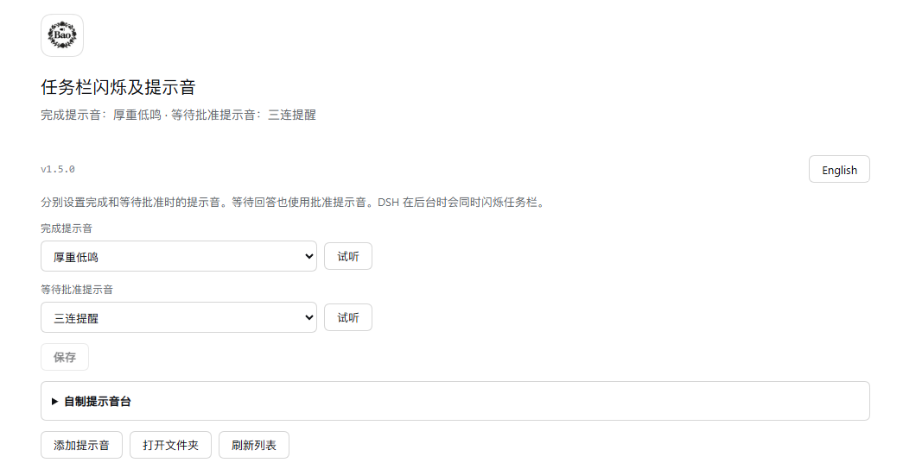
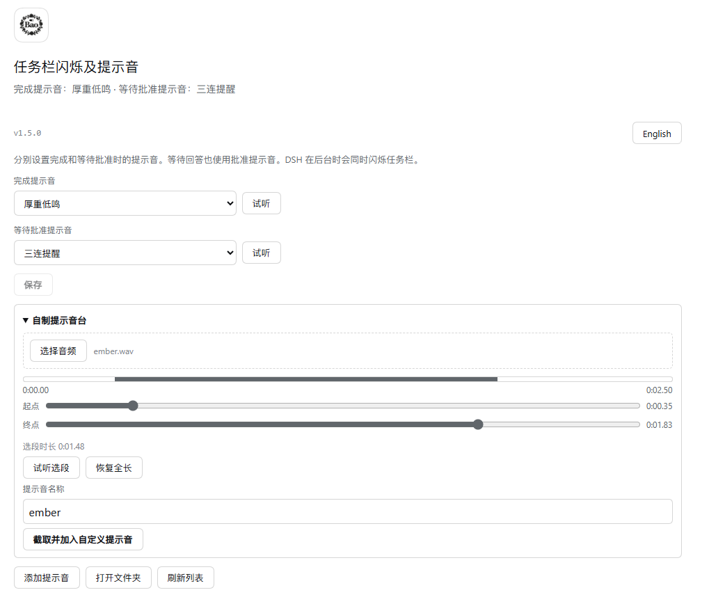

# 任务栏闪烁及提示音 · Taskbar Flash & Sounds

[English](README.md)

适用于 **Windows 桌面版 DeepSeek Harness（DSH）** 的本地 Host + Client 插件：一轮任务完成、Agent 提问、等待你批准时播放提示音；DSH 在后台时同时闪烁任务栏。

不弹 Toast、不建服务、不写注册表、不改 DSH 的审批策略。



## 它会做什么

- **一轮完成** —— 顶层会话正常结束一轮时提醒。手动停止、失败、分叉恢复和内部子任务完成，都不算“任务完成”。
- **等待回答** —— Agent 提出结构化问题（含计划审阅）时提醒；子任务真正需要你回答时也会提醒。
- **等待批准** —— Agent 卡在工具审批上时提醒。原有审批策略和回答流程保持不变。
- 每次提醒播一次提示音，前台后台都播，遵循系统当前音量与静音状态。
- **后台**时按 Windows 默认颜色闪烁任务栏按钮，切回窗口立刻停止；**前台**只响不闪，不抢焦点。

## 环境要求

| | |
| --- | --- |
| 系统 | Windows 10/11（manifest 里声明 `os: win32`） |
| 宿主 | DSH 桌面版 —— 任务栏闪烁需要 Host 进程里的真实窗口 |
| Shell | **PowerShell 7（`pwsh.exe`）**，原因见[为什么必须是 pwsh](#为什么必须是-pwsh) |
| Node | 18+（仅测试与音效生成用；插件本体无需构建） |

## 安装

插件的组成很直接：`index.js`（Host 侧）、`client.js`（浏览器侧）、`flash-window.ps1`（窗口操作）、`sounds/*.wav`，外加由插件管理器应用的 `cordis.patch.yml`。

**用插件管理器**

1. 打开 **设置 → 插件 → 添加插件**，指向本目录或仓库地址；本地目录安装是链接而不是复制。
2. 在插件页启用 **任务栏闪烁及提示音**（`taskbar-flash`）。

**手动安装**

```jsonc
// <profile>/package.json
{
  "dependencies": {
    "dsh-plugin-taskbar-flash": "link:C:/path/to/dsh-plugin-taskbar-flash"
  }
}
```

包自带 patch 条目，profile 的 `cordis.patch.yml` 里会出现：

```yaml
- insert:
    - id: taskbar-flash
      name: 'dsh-plugin-taskbar-flash'
```

源码目录必须保留：链接安装的插件直接从检出目录加载。

## 配置

**设置 → 插件 → 任务栏闪烁及提示音** 里有两个菜单：*完成提示音* 和 *待批准提示音*，选好后点 **保存** 即时生效。等待结构化回答使用待批准音。每个菜单旁有 **试听** 按钮，两个菜单都把内置提示音和自定义声音分组列出。

| 可选值 | 名称 | 说明 |
| --- | --- | --- |
| `chime` | 经典双音 | 原有 0.55 秒提示音 |
| `bright` | 清脆上行 | C6–E6–G6 上行三音 |
| `soft` | 柔和下行 | G5–E5 柔和两音 |
| `triple` | 三连提醒 | 待批准默认音，三声短促同音 |
| `deep` | 低沉钟声 | 392 Hz 低音钟 |
| `velvet` | 温暖低钟 | D3–A3–D4 叠置，2.3 秒长尾 |
| `ember` | 厚重低鸣 | 完成默认音，C3–G3–C4，2.5 秒 |
| `resolve` | 低沉完成音 | A2–E3–A3 缓慢上行，2.2 秒 |
| `system` | Windows 系统提示音 | 当前声音方案里的「星号」提示音 |
| `none` | 静音 | 只闪烁，不发声 |

内置音效全部是原创合成波形，生成源码在 `tools/generate-chime.py`；页面试听由浏览器用 Web Audio 按同一组参数复算，不访问网络。

## 用自己的声音

1. 点 **添加提示音**，选一个或多个文件，直接复制进 `custom-sounds/`，两个菜单立刻出现。重名不会覆盖（`mine.wav` 会存成 `mine-2.wav`）。
2. 想走文件管理器也行：点 **打开文件夹**，或打开插件目录下的 `custom-sounds/`（首次加载时创建），把音频放进去，再点 **刷新列表**。
3. 支持 `wav` `mp3` `m4a` `ogg` `flac` `wma`，单个文件不超过 12 MB。

**自制提示音台** —— 展开「自制提示音台」，选择或拖入一段本地音频，拖动起点、终点滑块缩短选区（默认整段），可只试听选段，命名后保存为 WAV 落到 `custom-sounds/`。原音频最多 32 MB / 10 分钟，导出选段最多 15 秒。保存后两个下拉框立即出现该片段。



上图是一段 2.50 秒的音频：进度条上颜色更深的那段就是选区，起点停在 0.35 秒、终点停在 1.83 秒，所以截出来是 **1.48 秒**——滑块下面那行「选段时长」显示的就是这个真正会被保存的长度。保存后片段会进两个菜单的「自定义声音」，并在原地用绿字确认。

配置里存的是 `file:<文件名>`，只认声音文件夹内的普通音频文件。文件移走后会回退到对应提醒的默认声音，设置页会给出提示。

## 实现要点

**Host 路由**（仅在部署带 `webServer` 时注册；提醒本身不依赖它）：

| 方法 | 路径 | 作用 |
| --- | --- | --- |
| GET | `/plugins/taskbar-flash/sounds` | `{ dir, sounds: [{ name, bytes }] }` |
| GET | `/plugins/taskbar-flash/sound/<name>` | 流式返回音频，支持 `Range` |
| POST | `/plugins/taskbar-flash/open-folder` | 确保目录存在并打开资源管理器 |
| POST | `/plugins/taskbar-flash/add?name=<文件名>` | 把上传的音频复制进声音文件夹，返回实际落盘名 |
| POST | `/plugins/taskbar-flash/trim` | 写入裁剪后的 PCM WAV 并返回文件名 |

**播放** —— `wav` 走 `PlaySoundW`（同步、最稳）；其余格式走 `mciSendString`，由系统解码器播放，超过 15 秒只播前 15 秒，避免长音频占住提醒进程。闪烁请求在声音之前发出，2.5 秒的长尾不会拖慢任务栏提示。

**窗口定位** —— `FlashWindowEx` + `FLASHW_TRAY | FLASHW_TIMERNOFG`，目标窗口按“可执行文件是 Host 进程祖先”来定位，不靠窗口标题猜，避免闪到其他应用。

**事件监听** —— `session/event` 经带作用域的 carrier 分发，因此监听器用 `{ global: true }` 注册；普通 `ctx.on` 可能被作用域过滤，漏掉完成、提问、审批事件。

### 为什么必须是 pwsh

DSH 的子进程沙箱会以 `spawn EPERM` 拒绝 Windows PowerShell 5.1。插件优先找 `%ProgramFiles%\PowerShell\7\pwsh.exe`，找不到才退回 5.1 并在控制台告警。

## 本地验证

```powershell
# 单元测试（直接跑文件；裸 `node --test test` 需要子进程，沙箱下会 EPERM）
node test/reminders.test.mjs
node test/sounds.test.mjs

# 只试声音不闪烁，逐个检查内置音效
pwsh -NoProfile -File flash-window.ps1 -HostPid $PID -Sound bright -SoundOnly

# 试一个自定义文件（wav 走 PlaySound，其余走 MCI）
pwsh -NoProfile -File flash-window.ps1 -HostPid $PID -Sound custom -SoundFile "C:\path\to\mine.mp3" -SoundOnly

# 检查目标窗口 / 发出闪烁 / 清除闪烁
pwsh -NoProfile -File flash-window.ps1 -HostPid <宿主进程号> -ProbeOnly
pwsh -NoProfile -File flash-window.ps1 -HostPid <宿主进程号> -Sound deep
pwsh -NoProfile -File flash-window.ps1 -HostPid <宿主进程号> -Clear
```

## 限制

- **浏览器里跑的 DSH** 没有同进程桌面窗口，任务栏闪烁不适用；Host 侧播声音仍需要 Windows。
- 普通回复里的自然语言问题没有独立事件，要等该轮结束才触发完成提醒。

## 致谢

独立实现，只使用 Windows 公开 API 与 DSH 公开事件。调研时发现社区已有 [dsh-notify-win](https://github.com/Andyqwe44/dsh-notify-win)（作者 Andyqwe44），未复制其代码与图标。

## 许可

[MIT](LICENSE) © 2026 Mr Bao。与 DeepSeek 官方无隶属或背书关系。
